<p align="center">
  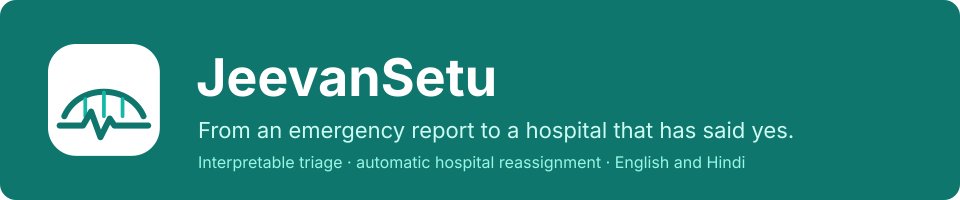
</p>

<p align="center">
  
  
  
  
  
</p>

**JeevanSetu** ("bridge of life") turns a citizen's emergency report into a hospital handover. The citizen reports what happened in three short steps. The server sets a preliminary priority with readable rules, ranks nearby hospitals that offer the right services, and asks the best one. If that hospital declines or does not reply within two minutes, the request moves to the next one automatically, and everyone sees the same live timeline.

It implements the paper *JeevanSetu: A Machine-Learning-Assisted Emergency Response Framework* (Nancy Verma, Satyam Pandey, Mohit Paliwal, Nandini Tomar, Mukesh Kumar Bhardwaj; Dept. of CSE (AI & ML), Dronacharya Group of Institutions, Greater Noida).

> [!IMPORTANT]
> This is a prototype. Hospitals, bed counts and staff are **simulated** and labelled as such. The priority rules are not a validated clinical triage tool, and the wound-photo model is informational only. **In a real emergency, call 112.**

<p align="center">
  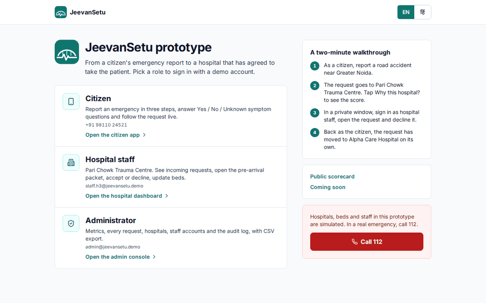
</p>

## Contents

- [What it does](#what-it-does)
- [How it works](#how-it-works)
- [Wound-photo model](#wound-photo-model)
- [Quick start](#quick-start)
- [Deploy online](#deploy-online)
- [Feature list status](#feature-list-status)
- [Tests](#tests)
- [Security and privacy](#security-and-privacy)
- [Project structure](#project-structure)
- [Limitations](#limitations)

## What it does

### Citizen app (mobile-first, English and Hindi)

<p align="center">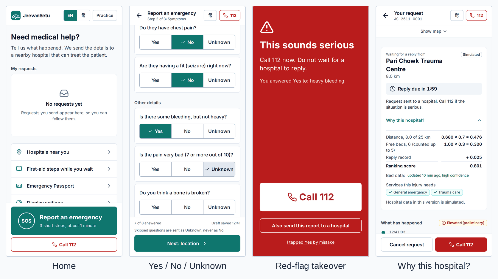</p>

- **One-tap SOS** with a Call 112 button on every screen.
- **Three-step report.**
  - Step 1: injury type, plus optional patient details and **voice input**.
  - Step 2: symptom questions answered **Yes / No / Unknown**. Unknown is never read as No.
  - Step 3: location by GPS, map pin or typed coordinates, with **versioned consent**.
  - The draft saves as you type, and an idempotency key stops double submits.
- **Red-flag takeover.** Any danger sign fills the screen with a single large Call 112 button.
- **Live status.** Shows the current hospital, the reply countdown and reassignment notices, and updates the moment anything changes. **"Why this hospital?"** shows every term of the score, plus how fresh the bed data is.
- **Optional photo** with a quality gate that rejects photos that are too dark, too bright or blurred.

<p align="center">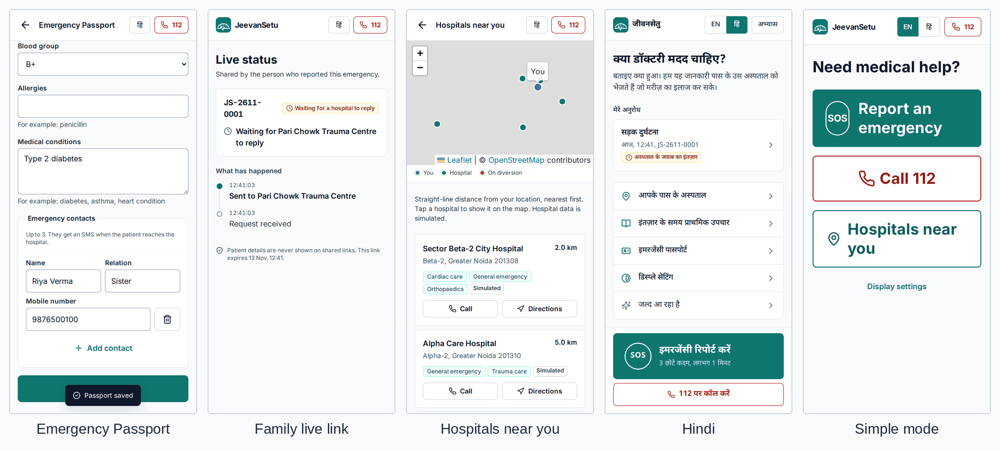</p>

- **Emergency Passport.** Blood group, allergies, conditions and emergency contacts, shared only with consent.
- **Family live link.** View-only and without patient details. It expires on its own.
- **Hospitals near you.** A map and a list with call and directions buttons.
- **Patient-side access log.** Shows which staff opened the case, and when.
- **Practice drill, first aid, outcome feedback.**
- **Accessibility.** Simple mode with three big buttons, larger text, and high contrast.

### Hospital staff dashboard

<p align="center">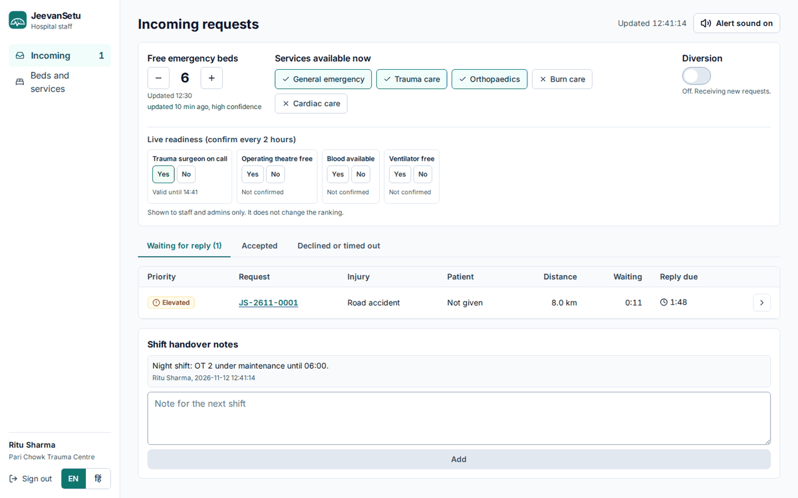</p>

- **Incoming queue.** Red flags first, with live timers and a sound alert.
- **One-tap resource panel.** Beds, services and diversion. Every figure shows its age and a confidence level.
- **Capability Truth Panel.** Staff confirm a trauma surgeon on call, a free OT, blood and a free ventilator. Each confirmation expires after two hours.
- **Shift handover notes.**

<p align="center">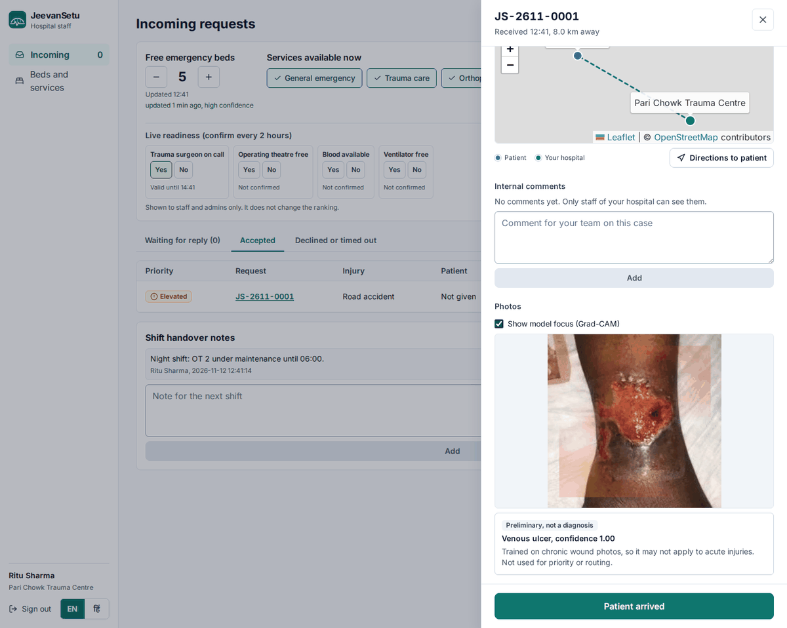</p>

- **Case drawer:**
  - priority reasons with the rule-set version
  - the pre-arrival packet, with a **QR code that opens the case when scanned at the gate**
  - a patient map with directions
  - internal comments
  - the photo with the model's preliminary prediction and **Grad-CAM** heat-map
- **Accept** (key A), **Decline with a reason** (key D), then **Patient arrived** to close the loop.

### Admin console

<p align="center">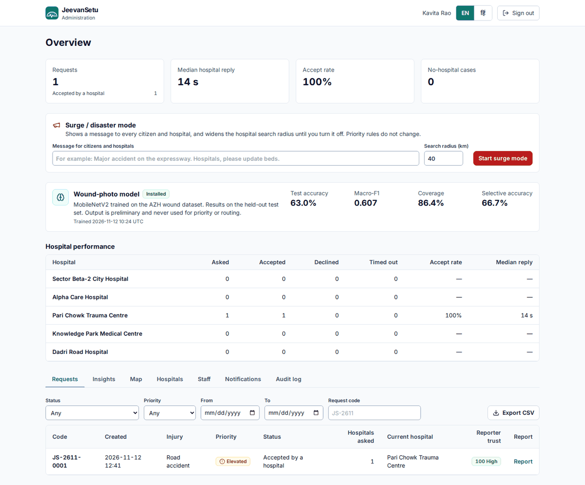</p>

- **Overview metrics.** Accept rate and reply time for each hospital, and the wound-model test results.
- **Surge / disaster mode.** A broadcast message plus a temporarily wider search radius.
- **Requests, hospitals, staff and audit log**, with filters and CSV export. Each request shows a reporter trust score that only admins can see.
- **Notifications outbox.** Mock SMS, WhatsApp, push and in-app providers, with phone numbers masked.

<p align="center">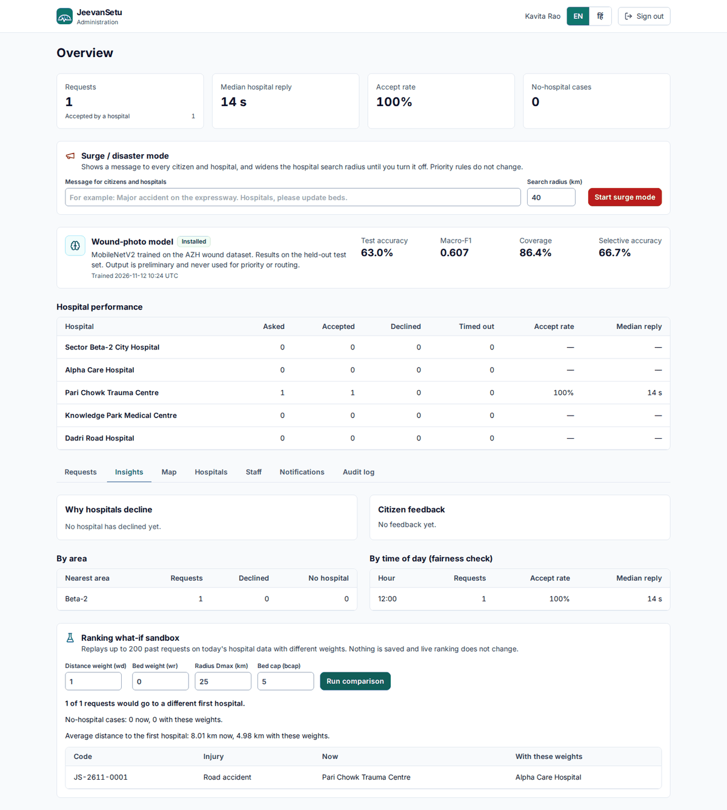</p>

- **Insights:** refusal reasons, area and time-of-day fairness, citizen feedback, and a **what-if sandbox**. The sandbox replays past requests with different ranking weights and changes nothing live.
- **Post-incident case report** for every request, which you can print or save as PDF. A **public scorecard** at `/scorecard` shows anonymous totals.

<p align="center">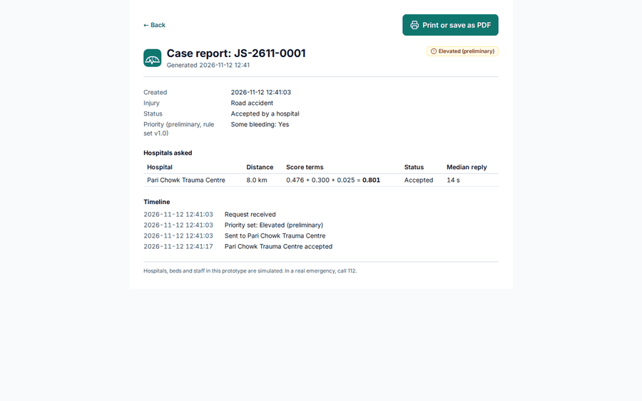</p>

## How it works

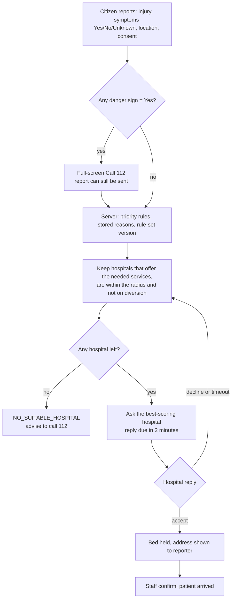

**Ranking.** Each eligible hospital *h* gets an additive score from distance *d*, reported free beds *b* and a small reliability term *r* (Eq. 8 of the paper, plus the reliability term):

$$
s(h) = w_d\left(1-\frac{d_h}{D_{max}}\right) + w_r\,\frac{\min(b_h, b_{cap})}{b_{cap}} + w_{rel}\,r_h
\qquad w_d=0.7,\ w_r=0.3,\ w_{rel}=0.05,\ b_{cap}=5,\ D_{max}=25\text{ km}
$$

A bed count that is missing or older than six hours still lets the hospital qualify, but it earns zero on the bed term and is flagged. The seeded hospitals reproduce the paper's worked example exactly (scores 0.776, 0.621 and 0.366).

**Safe reassignment.** No hospital is asked twice about the same request, and a request has at most one pending or accepted hospital at a time. Two simultaneous clicks, or a click racing the timeout, give one success and one HTTP 409.

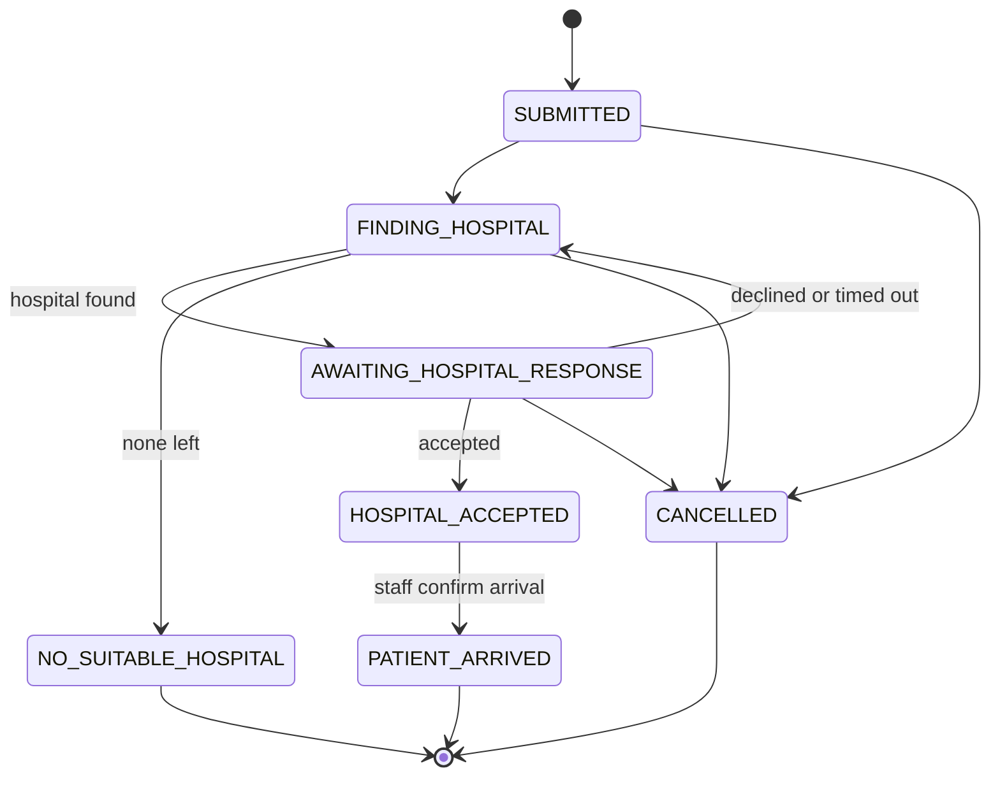

**Architecture.** One React client, one REST API, and modules for each concern. Screens update instantly through Server-Sent Events, with polling as a fallback.

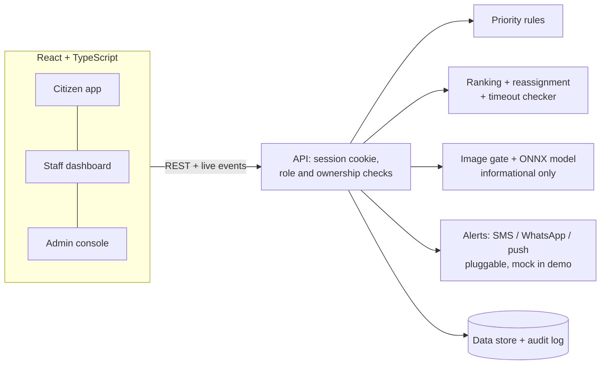

## Wound-photo model

The model is **MobileNetV2**, trained on the public **AZH wound dataset**. The dataset has four chronic wound classes: diabetic, pressure, surgical and venous ulcers. Training uses two-stage transfer learning and a class-weighted loss. When the model isn't confident enough, it answers **"Uncertain"** (abstention) instead of guessing. The model runs inside the Node server through ONNX Runtime Web (WebAssembly), and the Grad-CAM heat-map is computed from the last feature map. **Its output is never used for priority or hospital choice.**

| Backbone | Params | Test accuracy | Test macro-F1 | CPU time per photo |
| --- | --- | --- | --- | --- |
| **MobileNetV2** (used) | 2.23 M | **64.1%** | **0.628** | **24.9 ms** |
| EfficientNet-B0 | 4.01 M | 67.4% | 0.657 | 50.4 ms |
| ResNet-50 | 23.52 M | 62.5% | 0.592 | 120.6 ms |

These results come from one run on Kaggle (T4 GPU, seed 42) on the official test set: 464 training, 82 validation and 184 test images. With the abstention threshold τ = 0.63 chosen on validation data, MobileNetV2 answers 81.0% of test photos, at 69.1% accuracy. Pressure ulcers are the hardest class (F1 0.427). With so few images, accuracy moves by several points between runs; the paper's earlier run gave 71.7%.

<p align="center">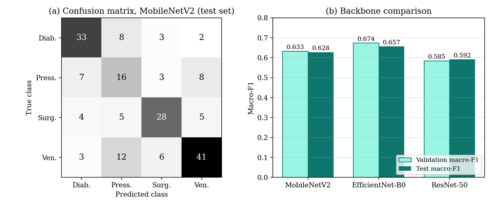</p>

**Train it yourself (about 10 minutes, free):**
1. Upload [`ml/JeevanSetu_Train_Wound_Model.ipynb`](ml/JeevanSetu_Train_Wound_Model.ipynb) to Kaggle (Create → New Notebook → File → Import Notebook).
2. Set **Accelerator: GPU** and **Internet: On**, then click **Run All**. The notebook downloads the dataset by itself.
3. Copy `wound_model.onnx` and `wound_model.json` from the `jeevansetu_model.zip` it produces into `server/models/`, and restart the app.

## Quick start

You only need **Node.js 20+**.

```bash
npm install
npm run dev
```

Open **http://localhost:5173/demo** and click a role.

For a presentation, build once and serve everything from one port with `npm start`, then open **http://localhost:8000/demo**. `npm run reset` clears all saved data; the demo data comes back on the next start.

| Role | Account |
| --- | --- |
| Citizen | Mobile `98110 24521`. The 6-digit code is shown on screen in the demo; no SMS is sent. |
| Hospital staff | `staff.h3@jeevansetu.demo` / `Demo@2026!` (Pari Chowk Trauma Centre). `staff.h1` to `staff.h5` cover the other hospitals. |
| Admin | `admin@jeevansetu.demo` / `Admin@2026!` |

<details>
<summary><b>Seeded hospitals (simulated, Greater Noida)</b></summary>

They are placed at the distances of the paper's worked example (Table VIII), measured from a patient near Alpha-1.

| Hospital | Distance | Services | Free beds |
| --- | --- | --- | --- |
| Sector Beta-2 City Hospital | 2.00 km | Emergency, orthopaedics, cardiac | 4 |
| Alpha Care Hospital | 4.98 km | Emergency, trauma | 1 |
| Pari Chowk Trauma Centre | 8.01 km | Emergency, trauma, orthopaedics | 6 |
| Knowledge Park Medical Centre | 11.93 km | Emergency, trauma, burn | not reported |
| Dadri Road Hospital | 30.02 km | Emergency, trauma, burn, cardiac | 8 |
</details>

<details>
<summary><b>Two-minute demo</b></summary>

1. On `/demo`, choose **Citizen**. Report a road accident near Greater Noida, tick consent and send. The request goes to Pari Chowk Trauma Centre; tap **Why this hospital?** to see the score.
2. In a private window, choose **Hospital staff**. Open the request, press **D**, pick a reason and decline.
3. Back as the citizen, the request has moved to **Alpha Care Hospital** on its own.
4. As staff of that hospital (`staff.h2@jeevansetu.demo`), accept it, then press **Patient arrived**.
5. As **Administrator**, look at the metrics, **Insights** (run the what-if sandbox), **Notifications** and the case **Report**.
</details>

<details>
<summary><b>Optional: the FastAPI reference backend</b></summary>

`backend/` holds the paper's reference implementation: FastAPI, SQLAlchemy, Alembic, Argon2id and 78 pytest tests. It covers the paper's core features. The newer features run in the portable Node server in `server/`, which needs no compiled add-ons and so also works on locked-down Windows laptops.

```bash
cd backend
python -m venv .venv && source .venv/bin/activate      # Windows: .venv\Scripts\Activate.ps1
python -m pip install -e ".[dev]"
cp .env.example .env
python -m alembic upgrade head && python -m app.seed
python -m pytest
python -m uvicorn app.main:app --reload --port 8000
```
</details>

## Deploy online

The server must keep running: it checks reply timeouts every 5 seconds and pushes live updates. So it is hosted on **Render**, and **Vercel** serves the website.

1. **Render (server).** New → Blueprint → choose this repository. `render.yaml` sets everything up. Check that `https://<your-app>.onrender.com/api/health` returns `{"status":"ok"}`.
2. **Vercel (website).** Add New → Project → this repository, with **Root Directory** set to `frontend`. If your Render address is not `https://jeevansetu.onrender.com`, change it in [`frontend/vercel.json`](frontend/vercel.json) first.

Render's free plan sleeps after 15 minutes without visitors, and data resets on restart. Open the link a minute before a demo.

## Feature list status

All **[MVP]** items are built and tested. Of the **[V2]** items, 14 of 25 are built. **[FUTURE]** items have data hooks and a clearly labelled "Coming soon" page in the app (`/coming-soon`). No ML or unvalidated feature changes priority or routing.

| # | Feature | Tag | Status |
| --- | --- | --- | --- |
| 1–11 | SOS home, 3-step report, OTP, draft, idempotency, live timeline, "Why this hospital?", red-flag and no-hospital states, photo gate, Hindi/English, practice drill, first aid, family share link | MVP | ✅ Done |
| 12 | Voice input (Hindi/English speech-to-text, user confirms) | V2 | ✅ Done (Chrome / Edge) |
| 13 | Offline-first PWA | V2 | ⬜ Next |
| 14 | SMS SOS fallback | V2 | ⬜ Next |
| 15 | Emergency Passport | V2 | ✅ Done |
| 16 | Patient-side access log | V2 | ✅ Done |
| 17 | Accessibility modes | V2 | ✅ Simple mode, larger text, high contrast (icon-only mode next) |
| 18 | Good Samaritan mode | V2 | ⬜ Next |
| 19 | Multi-patient report | V2 | ⬜ Next |
| 20 | Outcome feedback | V2 | ✅ Done |
| 21–23 | Crash detection, CPR volunteers, blood network | FUTURE | 🔜 Placeholder + data hooks |
| 24–28 | Staff queue with alerts, case drawer with map and Grad-CAM, resources and diversion, QR that opens the case, "Patient arrived" | MVP | ✅ Done |
| 29 | Capability Truth Panel (expires after 2 h) | V2 | ✅ Done |
| 30 | Inter-hospital referral | V2 | ⬜ Next |
| 31 | Handover voice note | V2 | ⬜ Next |
| 32 | Shift handover notes and case comments | V2 | ✅ Done |
| 33 | Payment / scheme filter | V2 | ⬜ Next |
| 34–35 | Driver mini-app, live ambulance location | V2 | ⬜ Next |
| 36 | Green corridor | FUTURE | 🔜 Placeholder |
| 37–39 | Metrics per hospital, management, audit log, CSV, reliability score | MVP | ✅ Done |
| 40–43 | What-if sandbox, refusal analytics, public scorecard, fairness monitor | V2 | ✅ Done |
| 44 | Surge / disaster mode | V2 | ✅ Done |
| 45 | Post-incident case report | V2 | ✅ Done |
| 46–47 | Bed predictor, black-spot heatmap | FUTURE | 🔜 Placeholder |
| 48–52 | Data freshness confidence, prank shield, access checks, metadata stripping, labels | MVP | ✅ Done |
| 53 | Sensitive case mode | V2 | ✅ Done |
| 54 | Data retention and consent withdrawal | V2 | ⬜ Next |
| 55 | Quality gate, replaceable MobileNetV2, abstention, Grad-CAM | MVP | ✅ Done |
| 56–57 | OOD detection, acute-injury classifier | FUTURE | 🔜 Placeholder |
| 58–60 | Pluggable alerts, real-time updates (SSE), seed data and README | MVP | ✅ Done |
| 61 | Road-network ETA (OSRM) | V2 | ⬜ Next |

## Tests

```bash
npm test                     # 15 Node tests: rules, Table VIII ranking, Algorithm 1, ONNX analyzer, API integration
npm run e2e                  # 10 Playwright browser tests (run `npx playwright install chromium` in frontend once)
cd frontend && npm test      # 6 Vitest tests: formatting, English/Hindi key parity
cd backend && python -m pytest   # 78 tests for the FastAPI reference backend
```

The browser tests cover:
- a report reaching the trauma centre, with the score terms
- the red-flag takeover
- the practice drill and the Hindi switch
- decline and reassignment
- cross-hospital 404
- the family link, accept and arrival
- the access log, notifications and the what-if sandbox
- surge mode and Simple mode

## Security and privacy

- **Sessions.** A random token in an httpOnly, SameSite=Strict cookie; only its hash is stored. Passwords use scrypt (Argon2id in the FastAPI backend). Sign-in codes are hashed, expire after 5 minutes and are rate-limited.
- **Access.** Role and ownership are checked on every request. Another hospital's or citizen's case returns **404**, and the attempt is audit-logged.
- **Images.** The real file content is checked. Photos are re-encoded, which removes EXIF and GPS data, kept privately, and every view is audit-logged.
- **Sharing.** The family link carries no patient details. The Emergency Passport is shared only with consent. In sensitive cases, alerts carry no names.
- **Abuse.** Reports are rate-limited per hour, and a reporter trust score is visible only to admins. The red-flag Call 112 screen appears on the phone before sending, so it is never blocked.

## Project structure

```
package.json        npm install / npm run dev / npm start for the whole project
server/             portable Node.js server (default)
  lib/              priority rules, ranking, Algorithm 1, freshness, alerts, live events, ONNX analyzer
  routes/           auth, citizen, staff, admin, extra (share, passport, insights, surge)
  models/           put wound_model.onnx and wound_model.json here
  test/             node:test unit and API tests
frontend/           React + TypeScript + Vite + Tailwind
  src/features/     citizen, staff, admin, public (track, scorecard, coming soon), demo
  e2e/              Playwright tests
ml/                 Kaggle / Colab training notebook
backend/            FastAPI reference backend from the paper
docs/               README images
render.yaml         Render blueprint
```

## Limitations

- **The wound model was trained on chronic ulcers**, not acute injuries, and accuracy varies between runs on this small dataset.
- **Nothing here is validated or real.** The priority rules are unvalidated, and the hospitals, beds and staff are simulated.
- **Distance is a straight line**, so roads and traffic are ignored.
- **One server process is assumed** by the timeout checker. There is no link to ERSS 112 and no ambulance dispatch.
- **No real messages are sent.** SMS and other alerts are mock providers, and the sign-in code is shown on screen in the demo.
